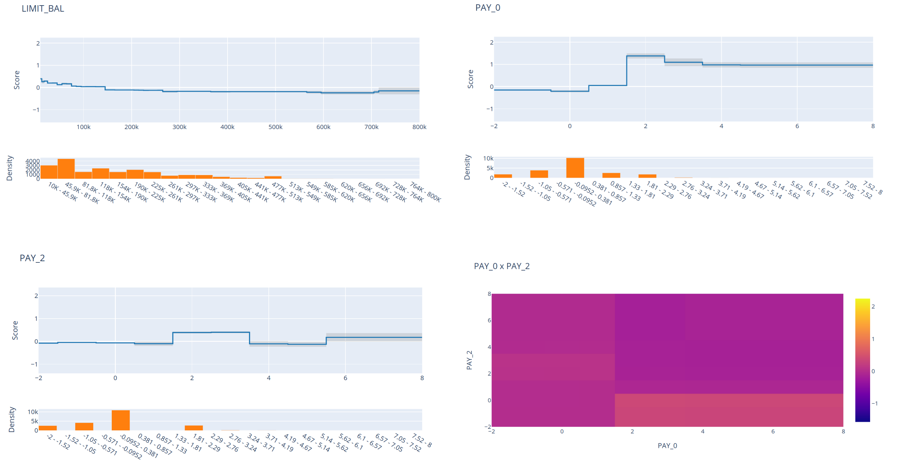
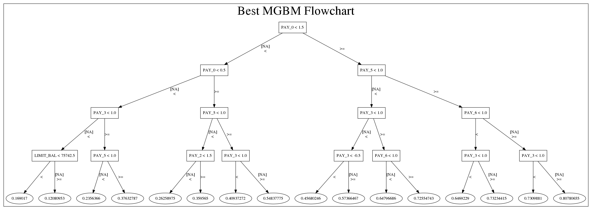
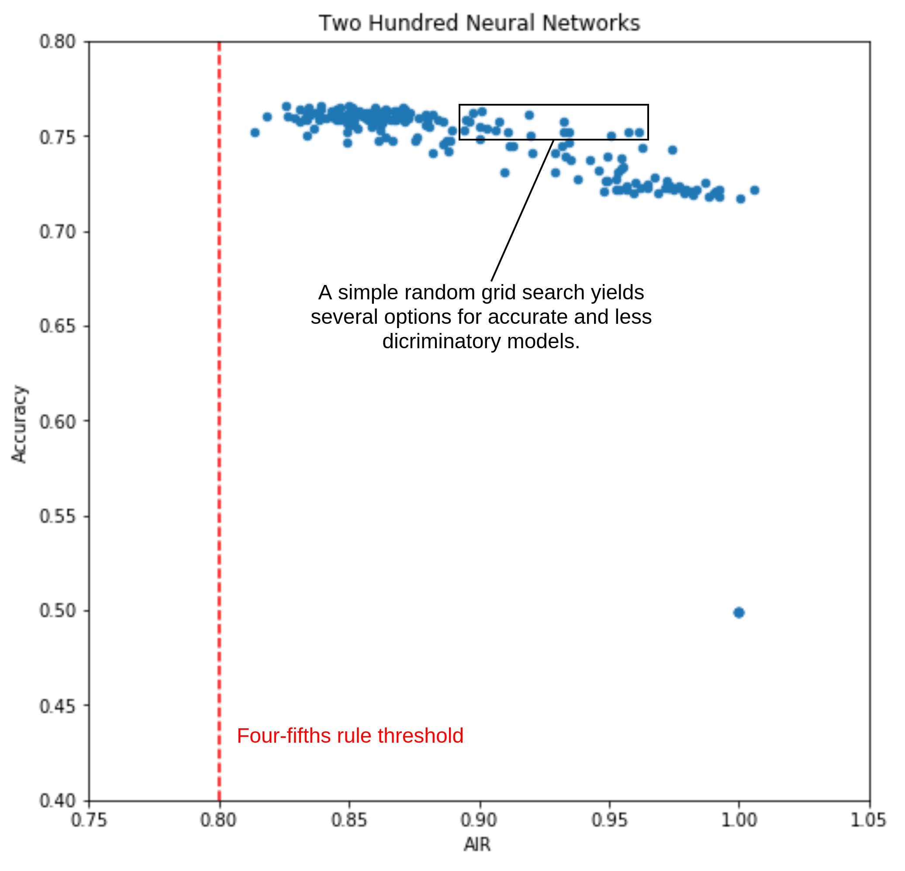
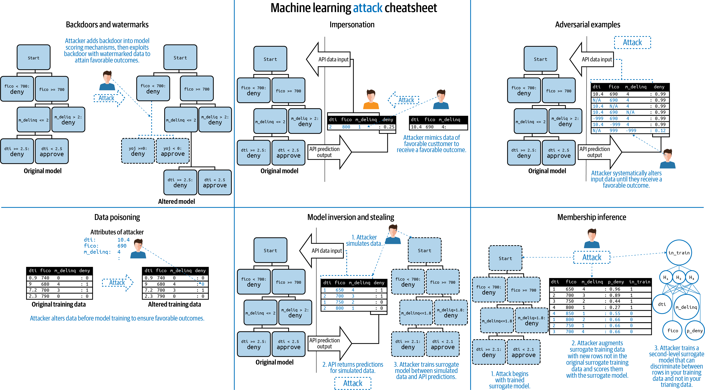
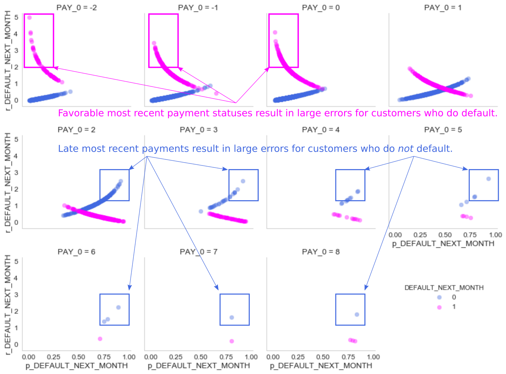
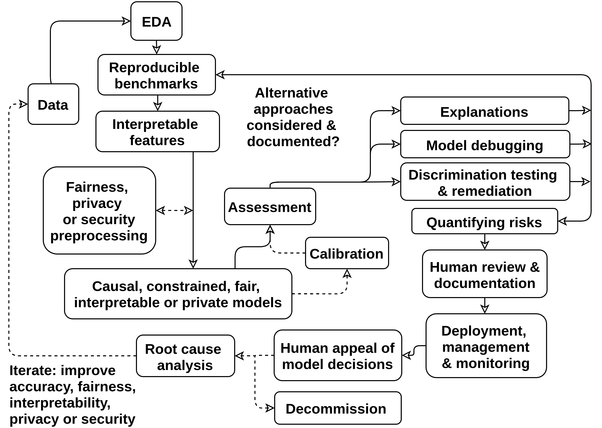

## GWU_DNSC 6330: Course Outline

Materials for a technical, nuts-and-bolts course about increasing transparency, fairness, robustness, and security in machine learning.

* Lecture 1: Explainable Machine Learning Models
* Lecture 2: Post-hoc Explanation
* Lecture 3: Bias Testing and Remediation
* Lecture 4: Machine Learning Security
* Lecture 5: Machine Learning Model Debugging
* Lecture 6: Foundation Models for Structured Data
* Lecture 7: Responsible Machine Learning Best Practices

Corrections or suggestions? Please file a [GitHub issue](https://github.com/jphall663/GWU_rml/issues/new).

***

## Preliminary Materials
 * [Syllabus](https://docs.google.com/document/d/1P9lpuRmTPtNJ0ZywBnF0QbkgWcBpd0NLeHkp2ydambI/edit?usp=sharing)
 * [Whiteboard Notation](https://docs.google.com/presentation/d/1Axf9dizaE3XvGRelBHfsnAlMUPFuMExQ2WNVwQBKMrw/edit?usp=sharing)

## Lecture 1: Explainable Machine Learning Models


<sub><sup>**Source:** [Simple Explainable Boosting Machine Example](https://github.com/jphall663/GWU_rml/blob/master/additional_material/lecture_1_ebm_example.ipynb)</sup></sub>

### Lecture 1 Class Materials

* [Lecture Notes](tex/lecture_1.pdf)
* Software Examples:
  * [Penalized GLM to Monotonic GBM](https://github.com/jphall663/GWU_rml/blob/master/lecture_1.ipynb)
  * [Explainable Boosting Machine](https://github.com/jphall663/GWU_rml/blob/master/additional_material/lecture_1_ebm_example.ipynb?flush_cache=true)
* [Assignment 1](assignment/tex/assignment_1.pdf):
  * [Model evaluation notebook](https://github.com/jphall663/GWU_rml/blob/master/assignment/eval.ipynb)
* Recommended reading: [_Machine Learning for High-Risk Applications_](https://www.oreilly.com/library/view/machine-learning-for/9781098102425/), Chapter 2 (pp. 33 - 50) and Chapter 6 (pp. 189 - 217)
  * Check availablity through GWU Libraries access to O'Reilly Safari
* [Lecture 1 Additional Material](additional_material/am1.md)

***

## Lecture 2: Post-hoc Explanation


<sub><sup>**Source:** [Global and Local Explanations of a Constrained Model](https://github.com/jphall663/GWU_rml/blob/master/lecture_2.ipynb)</sup></sub>

### Lecture 2 Class Materials

* [Lecture Notes](tex/lecture_2.pdf)
* [Software Example](https://github.com/jphall663/GWU_rml/blob/master/lecture_2.ipynb)
* [Assignment 2](assignment/tex/assignment_2.pdf)
* Recommended reading: [_Machine Learning for High-Risk Applications_](https://www.oreilly.com/library/view/machine-learning-for/9781098102425/), Chapter 2 (pp. 50 - 80) and Chapter 6 (pp. 208 - 230)
  * Check availablity through GWU Libraries access to O'Reilly Safari
* [Lecture 2 Additional Material](additional_material/am2.md)
  
***

## Lecture 3: Bias Testing and Remediation


<sub><sup>**Source:** [Lecture 3 Notes](tex/lecture_3.pdf)</sup></sub>

### Lecture 3 Class Materials

* [Lecture Notes](tex/lecture_3.pdf)
* [Software Example](https://github.com/jphall663/GWU_rml/blob/master/lecture_3.ipynb)
* [Assignment 3](assignment/tex/assignment_3.pdf)
* Recommended reading: [_Machine Learning for High-Risk Applications_](https://www.oreilly.com/library/view/machine-learning-for/9781098102425/), Chapter 4 and Chapter 10
  * Check availablity through GWU Libraries access to O'Reilly Safari
* [Lecture 3 Additional Material](additional_material/am3.md)

***   

## Lecture 4: Machine Learning Security


<sub><sup>**Source:** [Responsible Machine Learning](https://resources.oreilly.com/examples/0636920415947/blob/master/Attack_Cheat_Sheet.png)</sup></sub>

### Lecture 4 Class Materials

* [Lecture Notes](tex/lecture_4.pdf)
* [Software Example](https://github.com/jphall663/GWU_rml/blob/master/lecture_4.ipynb)
* [Assignment 4](assignment/tex/assignment_4.pdf)
* Recommended reading: [_Machine Learning for High-Risk Applications_](https://www.oreilly.com/library/view/machine-learning-for/9781098102425/), Chapter 5 and Chapter 11
* [Lecture 4 Additional Material](additional_material/am4.md)

***   

## Lecture 5: Machine Learning Model Debugging


<sub><sup>**Source:** [Real-World Strategies for Model Debugging](https://towardsdatascience.com/strategies-for-model-debugging-aa822f1097ce)</sup></sub>

### Lecture 5 Class Materials

* [Lecture Notes](tex/lecture_5.pdf)
* [Software Example](https://github.com/jphall663/GWU_rml/blob/master/lecture_5.ipynb)
* [Assignment 5](assignment/tex/assignment_5.pdf)
* Reading: [_Machine Learning for High-Risk Applications_](https://www.oreilly.com/library/view/machine-learning-for/9781098102425/), Chapter 3 and Chapter 8
  * Check availablity through GWU Libraries access to O'Reilly Safari
* [Lecture 5 Additional Material](additional_material/am5.md)

***   

## Lecture 6: Foundation Models for Structured Data

Lecture 6 is a placeholder for the replacement material.

* [Placeholder lecture notes](tex/lecture_6.pdf)

***

## Lecture 7: Responsible Machine Learning Best Practices



<sub><sup>A Responsible Machine Learning Workflow Diagram. **Source:** [*Information*, 11(3) (March 2020)](https://www.mdpi.com/2078-2489/11/3).</sup></sub>

### Lecture 7 Class Materials

* [Lecture Notes](tex/lecture_7.pdf)
* [Assignment 6 (Final Assessment)](assignment/tex/assignment_6.pdf)
* Reading: [_Machine Learning for High-Risk Applications_](https://www.oreilly.com/library/view/machine-learning-for/9781098102425/), Chapter 1 and Chapter 12
* [Lecture 7 Additional Material](additional_material/am7.md)


## Using the Course Software

Most lecture software examples use H2O-3. 

Run notebooks from the repository root so they can find course data and the `util` package. Install [uv](https://docs.astral.sh/uv/getting-started/installation/), [Visual Studio Code](https://code.visualstudio.com/), and the Python and Jupyter extensions. The course environment uses Python 3.11 and dependencies recorded in [`pyproject.toml`](pyproject.toml) and [`uv.lock`](uv.lock).

### Set up the H2O-3 environment

The default course environment uses H2O-3 with NumPy 1. Install a 64-bit Java Development Kit (JDK) using a package manager or OpenJDK distribution for your operating system, then set `JAVA_HOME` to its installation directory. H2O-3 3.46 lists Java 8–17 as supported; OpenJDK build 27 has also worked with these course notebooks, but is outside H2O's published support range ([H2O-3 requirements](https://docs.h2o.ai/h2o/latest-stable/h2o-docs/welcome.html)).

On macOS and Linux:

```sh
uv python install 3.11
uv sync
export JAVA_HOME=/path/to/java/home
code .
```

On Windows PowerShell:

```powershell
$env:JAVA_HOME = "C:\Path\To\Java\Home"
uv python install 3.11
uv sync
code .
```

For these notebooks, select the Python 3.11 environment in `.venv` as the notebook kernel (`.venv/bin/python` on macOS/Linux; `.venv\Scripts\python.exe` on Windows). 

### Other course notebooks

For notebooks that do not use H2O-3, create a separate NumPy 2 environment. Do not install the `course` and `legacy-h2o` groups into the same environment.

On macOS and Linux:

```sh
UV_PROJECT_ENVIRONMENT=.venv-numpy2 uv sync --group course --group notebook-execution --no-default-groups
code .
```

On Windows PowerShell:

```powershell
$env:UV_PROJECT_ENVIRONMENT = ".venv-numpy2"
uv sync --group course --group notebook-execution --no-default-groups
code .
```

Select the Python 3.11 environment in `.venv-numpy2` as the notebook kernel (`.venv-numpy2/bin/python` on macOS/Linux; `.venv-numpy2\Scripts\python.exe` on Windows). On macOS, install the XGBoost OpenMP runtime once with `brew install libomp`. Linux distributions generally provide the OpenMP runtime through their system packages. Windows users need the Microsoft Visual C++ Redistributable for XGBoost examples.

To use JupyterLab in the default H2O-3 environment, run `uv run jupyter lab` from the repository root.

See the [VS Code Jupyter guide](https://code.visualstudio.com/docs/datascience/jupyter-notebooks) for kernel selection details.

## Licenses

The software is licensed under the [MIT License](SOFTWARE_LICENSE.txt). Course content is licensed under the [Creative Commons Attribution-NonCommercial-ShareAlike 4.0 International License (CC BY-NC-SA 4.0)](CONTENT_LICENSE.txt).
